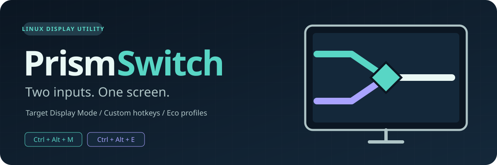

<p align="center"></p>

<h1 align="center">PrismSwitch</h1>
<p align="center"><strong>Deux entrées. Un écran.</strong><br>Redonnez une seconde vie à un iMac compatible comme moniteur DisplayPort sous Linux.</p>
<p align="center"><a href="README.md">English</a> · <a href="README.fr.md">Français</a> · <a href="README.zh-CN.md">简体中文</a></p>

## Fonctionnalités

- Basculement matériel entre la carte graphique interne et une source Mini DisplayPort externe, sans streaming.
- Raccourcis personnalisables, même sur l'écran de connexion grâce à keyd.
- Profils d'économie réversibles : plafond CPU, turbo, pause de services utilisateur choisis, extinction DPMS interne optionnelle.
- Assistant de configuration en terminal, commandes SSH de récupération, verrouillage des accès SMC et restauration des paramètres d'origine.
- Contrôleur Rust natif, petit helper C SMC amont inchangé, aucun runtime Python.
- Aucun compte, serveur, télémétrie ou boucle de surveillance.

## Compatibilité et preuves

| Modèle | État |
|---|---|
| iMac11,1, 27″ fin 2009 | Ancien déploiement validé visuellement en 2560 × 1440 ~60 Hz. Contrôleur Rust déployé : routage bidirectionnel, raccourcis keyd M/E, restauration CPU/DPMS et ventilation SMC automatique vérifiés sur la machine. Nouvelle confirmation visuelle/audio en attente. |
| iMac11,3, 27″ mi-2010 | Technique amont testée ; nouveau contrôleur expérimental sur activation explicite. |
| iMac10,1 | Expérimental ; uniquement si une dalle native 2560 × 1440 est détectée. |
| TDM Thunderbolt 2011–2014, 21,5″, Retina et ultérieurs | Non pris en charge par ce contrôleur. |

Linux x86-64, systemd, applesmc et son ABI d'indexation SMC, Rust 1.85+ (compilation uniquement), GCC et une source DisplayPort native compatible. DPMS : KDE Wayland avec kscreen-doctor ou X11 avec xset. Gardez un accès SSH pour la récupération. La forme Mini DisplayPort du connecteur ne garantit pas la compatibilité.

**Version 0.2.0 de prévisualisation :** le contrôleur Rust est déployé et les tests matériels de routage et de restauration réussissent sur un iMac11,1. La compatibilité élargie et une nouvelle confirmation visuelle/audio restent à vérifier. Aucune promesse de coupure électrique du GPU, de veille forcée du SSD, d'économie mesurée en watts ou de restitution audio universelle.

## Installation

Installez Rust/Cargo, GCC, les outils systemd et util-linux, ainsi que [keyd](https://github.com/rvaiya/keyd) pour les raccourcis (paquet extra sous Arch/CachyOS).

```sh
git clone https://github.com/GodsQuantum/PrismSwitch.git
cd PrismSwitch
./install.sh
sudo prismswitch configure
```

La compilation s'effectue sans privilèges et produit un binaire natif et un reçu SHA-256. Pour un build existant : sudo ./install.sh --prebuilt. L'installation ne bascule pas l'écran, n'installe pas de paquets et préserve la configuration existante. En présence d'autres fichiers keyd, utilisez configure --no-hotkeys et fusionnez manuellement les raccourcis générés par prismswitch keyd-config.

## Raccourcis

| Raccourci | Effet |
|---|---|
| Ctrl+Alt+M | Basculement normal, restauration préalable de tout profil éco. |
| Ctrl+Alt+E | Mode externe éco ; deuxième appui : retour interne et restauration. |

Les touches doivent parvenir au clavier de **l'iMac**, pas à celui de la source externe. L'assistant permet d'ajouter des profils et de choisir leurs raccourcis. Le pourcentage CPU exprime la plage de fréquence d'origine : 0 = minimum, 100 = plafond initial. L'état est temporairement conservé dans /run. Seuls les services d'un utilisateur non-root explicitement sélectionnés sont arrêtés. Le sommeil complet est inhibé pendant un profil.

Voir [l'exemple de configuration](config.example.json) et le [guide technique](docs/TECHNICAL.md).

## Commandes (sudo)

| Commande | Action |
|---|---|
| prismswitch on / off / toggle | Entrée externe / interne / basculement normal |
| prismswitch profile eco | Basculer un profil nommé |
| prismswitch status | Lire la demande de routage et le profil |
| prismswitch kick | Réinitialiser la liaison par off / 3 s / on |
| prismswitch restore | Restaurer l'énergie sans changer l'entrée |
| prismswitch configure | Assistant interactif |
| prismswitch hotkeys-install | Appliquer les raccourcis enregistrés et validés |
| prismswitch validate | Valider la configuration |
| prismswitch keyd-config | Afficher les raccourcis générés |

DisplayPort peut transporter le son. Choisissez la sortie audio numérique HDMI/DP de l'écran dans le système source si elle est détectée. PrismSwitch ne modifie pas les périphériques audio et ne vérifie pas l'audition.

Désinstallation : sudo ./uninstall.sh. Les paquets système, les autres réglages keyd, l'entrée actuelle et la configuration PrismSwitch sont conservés.

## Développement

cargo test --locked et shellcheck build.sh install.sh uninstall.sh. Les tests matériels restent distincts des tests CI.

[Guide technique](docs/TECHNICAL.md) · [Kit graphique](branding/PRESSKIT.md) · [README amont](docs/UPSTREAM_README.md) · [Licences et crédits](NOTICE.md)

Fork indépendant de floe/smc_util. Le nouveau contrôleur est GPL-2.0-only ; les fichiers d'origine conservent leurs licences respectives. Aucune affiliation Apple ni approbation de l'amont.
