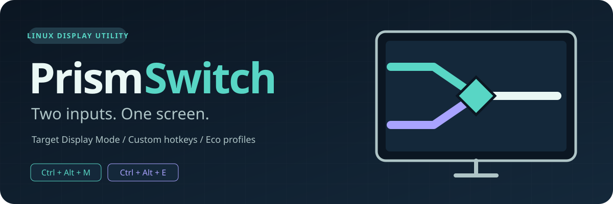

<p align="center"></p>

<h1 align="center">PrismSwitch</h1>
<p align="center"><strong>Two inputs. One screen.</strong><br>Bring a compatible vintage iMac back to life as a DisplayPort monitor under Linux.</p>

<p align="center"><a href="README.md">English</a> · <a href="README.fr.md">Français</a> · <a href="README.zh-CN.md">简体中文</a></p>
<p align="center">
  <a href="https://github.com/GodsQuantum/PrismSwitch/actions/workflows/ci.yml"></a>
  
  
  <a href="LICENSE"></a>
</p>

## Give your display a second life

Switch the physical display input, not a remote desktop stream. PrismSwitch builds on Florian Echtler's SMC reverse engineering and the original Linux SMC utility.

- Normal switching between the iMac's own GPU and an external Mini DisplayPort source.
- Customizable keyboard shortcuts, including at the login screen with **keyd**.
- Multiple reversible power profiles: CPU cap, turbo control, optional local user-service pausing and optional internal DPMS blanking.
- Terminal setup wizard, SSH recovery commands, serialized SMC access, readback and rollback.
- Native Rust controller; the original small C SMC helper is retained unchanged. No Python runtime.
- Local operation without a cloud account, server, polling loop or telemetry.

## Compatibility and evidence

| Model | Status |
|---|---|
| iMac11,1 (27-inch, late 2009) | Prior deployment visually verified at 2560 × 1440 ~60 Hz. Rust controller deployed: both routing directions, keyd M/E sequences, CPU/DPMS restoration and automatic SMC fans verified on hardware. Fresh visual/audio confirmation pending. |
| iMac11,3 (27-inch, mid 2010) | Original upstream technique tested; new controller experimental, opt-in. |
| iMac10,1 | Experimental, opt-in only with native 2560 × 1440 panel detection. |
| 2011–2014 Thunderbolt TDM, 21.5-inch, Retina and later models | Not supported by this controller. |

Linux x86-64, systemd, applesmc key-index sysfs ABI, Rust 1.85+ (build only), GCC and a compatible native DP source/cable are required. The optional DPMS integration targets KDE Wayland or X11 with the corresponding tools. Keep SSH access available for recovery. Do not assume hardware compatibility merely because an iMac has a Mini DisplayPort-shaped connector.

**Preview:** the Rust controller is deployed and hardware routing/rollback tests pass on one iMac11,1. Broader model coverage and fresh visual/audio confirmation remain pending. No claim of GPU electrical shutdown, SSD standby, measured watt savings or universally working audio.

## Install

Install Rust/Cargo, GCC, systemd tools and util-linux. For hotkeys install [keyd](https://github.com/rvaiya/keyd) from your distribution or its official instructions. On Arch/CachyOS the package is available in extra. KDE Wayland DPMS needs kscreen-doctor; X11 DPMS needs xset.

```sh
git clone https://github.com/GodsQuantum/PrismSwitch.git
cd PrismSwitch
./install.sh
sudo prismswitch configure
```

The unprivileged build creates a native binary and checksummed build receipt; only installation is elevated. For an existing build use sudo ./install.sh --prebuilt. The installer does not switch the display, install packages or change an existing configuration. Existing keyd configurations are never overwritten: use the wizard with --no-hotkeys and merge the output of prismswitch keyd-config into your own configuration. The keys must be received by the **iMac's** keyboard, not the external source computer.

## Default shortcuts

| Shortcut | Behavior |
|---|---|
| Ctrl+Alt+M | Normal display toggle; restore any active power profile first. |
| Ctrl+Alt+E | Activate the external eco profile; press again to return to internal and restore settings. |

Create additional named profiles and choose their shortcuts in the wizard. CPU range percentage is relative to the original allowed range: 0 is the minimum, 100 retains the current cap. Power settings are stored temporarily under /run and restored on exit. Only explicitly selected non-root user services can be paused. System sleep is inhibited while a profile is active. Actual energy use depends on hardware.

See [example configuration](config.example.json) and [technical guide](docs/TECHNICAL.md) for details.

## CLI

| Command (sudo) | Action |
|---|---|
| prismswitch on / off / toggle | Select external / internal / toggle normally |
| prismswitch profile eco | Toggle a named power profile |
| prismswitch status | Read SMC routing request and controller profile |
| prismswitch kick | Re-train by switching off, waiting three seconds, switching on |
| prismswitch restore | Restore power settings without changing input |
| prismswitch configure | Interactive setup |
| prismswitch hotkeys-install | Apply validated saved keyd bindings |
| prismswitch validate | Validate configuration |
| prismswitch keyd-config | Print generated keyd bindings |

DisplayPort can also carry audio. If the source detects an audio-capable display, select its digital HDMI/DP audio sink in the source desktop's sound settings. The routing controller does not change audio devices or verify speaker output.

To uninstall, run sudo ./uninstall.sh from this checkout. The installer leaves system packages, other keyd configuration, current input and saved PrismSwitch configuration alone.

## Development

Run cargo test --locked and shellcheck build.sh install.sh uninstall.sh. CI checks the C helper, Rust controller and shell scripts; hardware tests are explicitly separate.

[Technical guide](docs/TECHNICAL.md) · [Brand kit](branding/PRESSKIT.md) · [Original upstream README](docs/UPSTREAM_README.md) · [License and credits](NOTICE.md)

Independent GPL-2.0-only controller and fork of [floe/smc_util](https://github.com/floe/smc_util). Original files retain their respective licenses. No affiliation with Apple or upstream endorsement.
