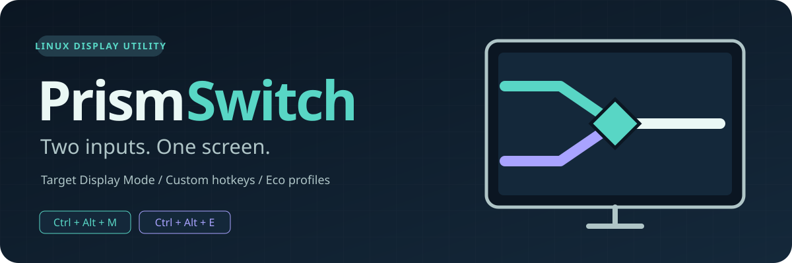

<p align="center"></p>

<h1 align="center">PrismSwitch</h1>
<p align="center"><strong>双输入，一块屏幕。</strong><br>在 Linux 下让兼容的老款 iMac 重获新生，成为 DisplayPort 显示器。</p>
<p align="center"><a href="README.md">English</a> · <a href="README.fr.md">Français</a> · <a href="README.zh-CN.md">简体中文</a></p>

## 功能

- 在 iMac 内置显卡和外部 Mini DisplayPort 信号源之间进行硬件切换，无需远程桌面串流。
- 可自定义快捷键，通过 keyd 可在登录界面使用。
- 可恢复的多种节能配置：CPU 频率上限、Turbo 控制、选择性暂停用户服务，以及可选的内部 DPMS 熄屏。
- 终端配置向导、SSH 恢复命令、串行化 SMC 访问、状态读回和回滚。
- 无需云账户、网络服务、遥测或持续轮询。

## 兼容性与验证

| 机型 | 状态 |
|---|---|
| iMac11,1（2009 年末 27 英寸） | 旧部署已实机确认 2560 × 1440、约 60 Hz 正常显示；新控制器已通过真实 SMC 只读验证，完整切换仍待验证。 |
| iMac11,3（2010 年中 27 英寸） | 上游原始方法曾验证；新控制器为实验支持，需明确启用。 |
| iMac10,1 | 实验支持，仅允许检测到原生 2560 × 1440 面板的设备。 |
| 2011–2014 年 Thunderbolt TDM、21.5 英寸、Retina 及更新机型 | 本控制器不支持。 |

需要 Linux x86-64、systemd、applesmc 的 SMC 键索引 sysfs 接口、Python 3.9+、GCC 和兼容的原生 DP 信号源及线缆。KDE Wayland 的 DPMS 需要 kscreen-doctor，X11 需要 xset。请保留 SSH 连接以便恢复。接口形状相同不代表硬件兼容。

**0.1.0 预览版：** 旧部署已在一台设备上正常工作，新通用控制器尚未完成全部硬件认证。不承诺显卡完全断电、强制 SSD 休眠、实测功耗下降或所有设备均能正常播放声音。

## 安装

安装 Python、GCC、systemd 工具和 util-linux。快捷键需要 [keyd](https://github.com/rvaiya/keyd)（Arch/CachyOS 的 extra 软件仓库提供）。

```sh
git clone https://github.com/GodsQuantum/PrismSwitch.git
cd PrismSwitch
sudo ./install.sh
sudo prismswitch configure
```

安装程序不会自动切换屏幕、安装系统软件包或覆盖现有配置。如果已有其他 keyd 配置，请使用 configure --no-hotkeys，并手动合并 prismswitch keyd-config 输出的绑定。

## 快捷键

| 快捷键 | 功能 |
|---|---|
| Ctrl+Alt+M | 普通输入切换，先恢复任何已启用的节能配置。 |
| Ctrl+Alt+E | 启用外部输入节能模式；再次按下恢复内置输入及原始设置。 |

快捷键必须由 **iMac** 接收，而不是外部信号源电脑。配置向导允许添加多个命名配置并设置快捷键。CPU 百分比基于原有允许频率范围：0 表示最低频率，100 表示原有上限。状态暂存在 /run，仅暂停明确指定的非 root 用户服务。节能模式启用期间会阻止系统休眠。

参阅[配置示例](config.example.json)和[技术指南](docs/TECHNICAL.md)。

## 命令（使用 sudo）

| 命令 | 功能 |
|---|---|
| prismswitch on / off / toggle | 外部 / 内部输入 / 普通切换 |
| prismswitch profile eco | 切换命名节能配置 |
| prismswitch status | 读取 SMC 路由请求及配置状态 |
| prismswitch kick | 切回内部，等待三秒，再切换外部 |
| prismswitch restore | 恢复电源设置，不改变输入 |
| prismswitch configure | 交互式配置 |
| prismswitch validate | 验证配置 |
| prismswitch keyd-config | 输出生成的快捷键配置 |

DisplayPort 可以传输音频。若外部信号源识别到显示器的数字音频输出，请在其桌面声音设置中选择 HDMI/DP 输出。PrismSwitch 不修改音频设备，也无法验证扬声器是否实际发声。

卸载：sudo ./uninstall.sh。保留系统软件包、其他 keyd 设置、当前输入和 PrismSwitch 配置。

## 开发

运行 python3 -m unittest discover -s tests -v 与 shellcheck install.sh uninstall.sh。自动化测试与实际硬件验证分开。

[技术指南](docs/TECHNICAL.md) · [品牌素材](branding/PRESSKIT.md) · [上游 README](docs/UPSTREAM_README.md) · [许可证与致谢](NOTICE.md)

本项目是 floe/smc_util 的独立分支。新控制器采用 GPL-2.0-only，原有文件保留各自许可证。与 Apple 无隶属关系，亦不代表上游认可。
